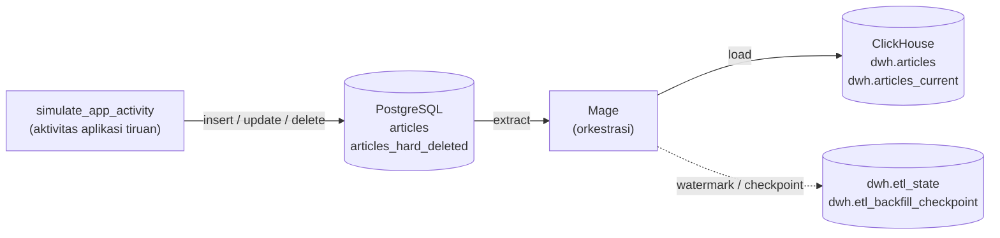

# Pipeline ETL Data Artikel Kumparan: database PostgreSQL → data warehouse ClickHouse dengan Mage untuk orchestration

Untuk menjawab skill test Data Engineer di Kumparan, dikembangkan serangkaian pipeline yang berfungsi untuk memindahkan tabel `articles` dari database operasional (PostgreSQL) ke data warehouse (ClickHouse) **setiap jam**, dilengkapi dengan penanganan data historis sejak 2016 dan penanganan sinkronisasi data yang mengalami hard delete. Seluruh sistem berjalan di Docker Compose untuk mempermudah penyamaan environment lintas device.

## Daftar isi
1. [Arsitektur](#arsitektur)
2. [Cara menjalankan](#cara-menjalankan)
3. [Desain dan alasan](#desain-dan-alasan)
4. [Bonus 1: data historis sejak 2016](#bonus-1-data-historis-sejak-2016)
5. [Bonus 2: hard delete](#bonus-2-hard-delete)
6. [Asumsi](#asumsi)
7. [Pengujian dan demo](#pengujian-dan-demo)
8. [Keterbatasan dan rencana produksi](#keterbatasan-dan-rencana-produksi)
9. [Struktur repo](#struktur-repo)
10. [Pemecahan masalah](#pemecahan-masalah)
11. [Pengungkapan penggunaan AI](#pengungkapan-penggunaan-ai)

## Arsitektur



| Komponen | Pilihan | Alasan singkat |
|---|---|---|
| Database | PostgreSQL 16 | Familiar digunakan, punya fungsi trigger untuk mencatat hard delete |
| Warehouse | ClickHouse 24.8 | sudaht berformat seperti Warehouse kolumnar sungguhan dan dapat dijalankan di Docker. Tidak butuh akun cloud seperti GCP atau AWS, cocok untuk pengembangan |
| Orkestrasi | Mage | mudah dioperasikan via UI |


## Cara menjalankan

Prasyarat: Docker Desktop (Compose v2). Tidak perlu akun cloud.

```bash
git clone <repo-ini> && cd kumparan-etl-mage
cp .env.example .env          # cek kredensial lebih dahulu jika diperlukan
docker compose up -d --build
```

Perintah `docker compose up -d --build` saat pertama kali menyala langsung mengaktifkan:
- Service Postgres dan membuat tabel `articles` dan `articles_hard_deleted`, **tanpa data**.
- Service ClickHouse dan membuat database `dwh` dengan semua tabel yang dikonfigurasi sebelumnya, **tanpa data**.
- Mage aktif dan GUI-nya dapat diakses di http://localhost:6789 (project `kumparan_etl`).

Seluruh struktur tabel dibuat oleh file DDL di `postgres/init/` dan `clickhouse/init/`.

### Urutan menjalankan pipeline

Buka Mage, melalui GUI jalankan pipeline dengan urutan sebagai berikut: 
`data_generator (once)` → `data_backfill (once)` → `data_streaming (hourly)` -> `data_delete_handler (hourly)` → `data_insert_simulation (per 10 menit)` 

selain itu disediakan juga `reset_data` jika ingin mengulang pengisian data dari awal

selain via GUI, pipeline dapat dijalankan lewat CLI sebagai berikut:

```bash
# TODO: verifikasi sintaks pada versi Mage yang dipakai, lalu hapus tanda ini
docker compose exec mage mage run kumparan_etl data_generator
docker compose exec mage mage run kumparan_etl data_backfill
docker compose exec mage mage run kumparan_etl data_streaming
docker compose exec mage mage run kumparan_etl data_delete_handler
docker compose exec mage mage run kumparan_etl data_insert_simulation
```

| Langkah | Pipeline | Hasil |
|---|---|---|
| 1 | `data_generator` | mengenerate artikel dummy dengan jumlah yang dapat disesuaikan dan tersimpan di Postgres |
| 2 | `data_backfill` | mengambil seluruh data historis ke dalam database Postgres dalam bentuk partisi berdasarkan bulan |
| 3 | `data_streaming` | Memindahkan artikel baru/berubah per jangka waktu tertentu (per jam) |
| 4 | `data_delete_handler` | Menandai artikel yang dihapus fisik di database |
| 5 (opsional) | `data_insert_simulation` | Membuat aktivitas aplikasi tiruan agar dapat terlihat aktivitas update, insert, delete|


### Penjadwalan per jam

Jadwal dibuat di Mage GUI dan dapat dilihat di file `.yml` di folder tiap-tiap pipeline `mage/kumparan_etl/pipelines`.

### Memeriksa hasil

| Metode | Kredensial |
|---|---|
| Postgres (DBeaver) | Host `localhost`, port `POSTGRES_PORT`, database/user/password dari `.env` |
| ClickHouse (DBeaver) | Driver ClickHouse, host `localhost`, port `8123`, database `dwh` |
| ClickHouse (browser) | http://localhost:8123/play |

```sql
-- Data bersih yang bisa digunakan analisis (versi terbaru)
SELECT count() FROM dwh.articles_current;

-- Perbandingan baris raw data dan hasil cleansing 
SELECT count() FROM dwh.articles;
SELECT count() FROM dwh.articles FINAL;
```


## Desain dan alasan

**Watermark `updated_at`.** Soal mendefinisikan `updated_at` terisi saat artikel dibuat dan saat diubah, jadi kolom ini menangkap artikel baru, hasil edit, dan soft delete. `created_at` dan `id` tidak berubah ketika artikel diedit, sehingga tidak cukup. Watermark disimpan di `dwh.etl_state`.

**Watermark digeser paling akhir.** Urutannya: baca watermark → ambil data → tulis ke warehouse → baru geser watermark. Kalau penulisan gagal, watermark tidak bergeser dan run berikutnya mengulang dari titik yang sama. Paling buruk data terkirim dua kali, tidak pernah hilang (*at-least-once*). Itu aman karena penulisannya idempoten.

**Overlap 5 menit.** Pembacaan dimulai 5 menit sebelum watermark. Transaksi yang commit terlambat tetap terjaring, dan pembulatan waktu (Postgres mikrodetik, ClickHouse milidetik) tidak membuat baris terlewat. Baris yang terbaca dua kali dipadatkan oleh ReplacingMergeTree.

**ReplacingMergeTree dengan `_version`.** ClickHouse menyimpan data dalam bagian-bagian yang pada dasarnya tidak diubah. Upsert dilakukan dengan menambah baris versi baru, dan baris lama dibuang saat merge di latar belakang. `_version` adalah waktu sync dalam milidetik, sehingga versi yang disync belakangan menang. Karena merge berjalan asinkron, pembacaan memakai `FINAL`. View `dwh.articles_current` sudah membungkusnya, jadi analis cukup `SELECT` dari view.

**Partisi bulanan berdasarkan `created_at`.** `created_at` tidak pernah berubah, sehingga semua versi satu artikel selalu berada di partisi yang sama (syarat agar dedup bekerja). Partisi bulanan cocok untuk volume sekitar satu juta artikel per hari dan memudahkan backfill atau penghapusan per bulan.

**Penulisan per partisi.** ClickHouse menolak satu INSERT yang menyentuh lebih dari 100 partisi. Hal ini muncul langsung saat initial load 10 tahun data. Penulisan dikelompokkan per bulan `created_at`, satu INSERT untuk satu partisi.

**Transformasi minimal.** Soal tidak menyebut transformasi bisnis. Yang dilakukan: semua timestamp diseragamkan ke UTC, `content` kosong diisi string kosong, dan kolom teknis (`_is_hard_deleted`, `_version`) ditambahkan. Data mentah tetap setia ke sumber. Kesiapan analitik diberikan lewat view `articles_current`. Lapisan model yang lebih kaya (misalnya dbt) dicatat sebagai rencana produksi.

**Data dummy dibuat oleh pipeline Mage, struktur tabel oleh DDL.** Struktur tabel meniru skema aplikasi yang sudah ada, jadi dibuat saat container menyala. Data dummy adalah pekerjaan sekali jalan dan dilakukan pipeline terpisah yang tidak terjadwal.

## Bonus 1: data historis sejak 2016

Masalahnya: warehouse masih kosong sementara sumber sudah berisi sepuluh tahun data. Menjalankan pipeline per jam apa adanya akan mencoba menarik seluruh isi tabel dalam satu query.

Yang dipertimbangkan dan diimplementasikan:

| Pertimbangan | Penerapan |
|---|---|
| Jalur terpisah untuk sejarah dan perubahan rutin | Pipeline `articles_backfill` dan `articles_incremental` |
| Jangan memuat sekaligus | Dipecah per bulan `created_at` (sama dengan partisi ClickHouse) |
| Bisa dilanjutkan jika gagal | Checkpoint per bulan di `dwh.etl_backfill_checkpoint` |
| Aman diulang | ReplacingMergeTree membuat penulisan ulang satu chunk tidak menggandakan data |
| Perubahan selama backfill tidak boleh hilang | Titik awal `t0` dikunci **sebelum** backfill mulai. Setelah selesai, watermark incremental disetel ke `t0`, bukan ke waktu selesai |
| Melindungi pipeline incremental | Pengaman: bila perubahan melebihi 100.000 baris, run gagal dengan pesan agar memakai backfill |
| Validasi | Block terakhir backfill membandingkan jumlah baris `created_at <= t0` di kedua sisi |
| Query incremental harus cepat | Index `(updated_at, id)` di Postgres |

Yang direncanakan untuk produksi (tidak diimplementasikan): membaca dari read replica di luar jam sibuk, chunk lebih kecil (per hari atau rentang `id`) karena satu bulan bisa mencapai puluhan juta baris, throttling, dan validasi checksum per partisi.

## Bonus 2: hard delete

Masalahnya: pipeline bertanya ke sumber "baris mana yang berubah?", sedangkan baris yang dihapus fisik tidak bisa ditanyakan. Warehouse akan terus menyimpan artikel yang sudah tidak ada. Soft delete tidak bermasalah karena barisnya tetap ada dan `updated_at` ikut berubah.

Opsi yang dipertimbangkan:

| Opsi | Kelebihan | Kekurangan |
|---|---|---|
| **A. Trigger + tabel tombstone** (dipilih) | Murah, sederhana, mudah didemokan | Butuh akses mengubah sumber. Tidak tercatat jika trigger dimatikan atau memakai `TRUNCATE` |
| B. Rekonsiliasi ID (bandingkan seluruh id kedua sisi) | Tidak mengubah sumber, menjaring semua jenis penghapusan | Mahal di tabel besar, perlu dibatasi per partisi |
| C. CDC (Debezium dari WAL) | Paling akurat dan hampir real-time | Infrastruktur berat (Kafka, Debezium) |
| D. Checksum per partisi | Efisien untuk tabel besar | Hanya mendeteksi ada perbedaan, belum tahu baris mana |

**Implementasi:** trigger `AFTER DELETE` di Postgres mencatat id yang dihapus ke `articles_hard_deleted`. Pipeline `articles_hard_delete` membaca catatan baru, mengambil versi terakhir artikel dari warehouse, lalu menulis salinannya sebagai baris baru dengan `_is_hard_deleted = 1` dan `_version` lebih tinggi. Penghapusan fisik tidak dilakukan di ClickHouse (mahal, dan tidak meninggalkan jejak audit). View `articles_current` menyaring baris bertanda hapus. Pipeline ini idempoten: baris yang sudah ditandai tidak ditulis lagi, dan pembacaan tombstone mundur 1.000 event karena nomor dari sequence bisa commit tidak berurutan.

**Rekomendasi produksi:** CDC (opsi C), dilengkapi rekonsiliasi ID berkala (opsi B) sebagai jaring pengaman.

## Asumsi

1. Setiap perubahan pada artikel, termasuk soft delete, memperbarui `updated_at`. Di project ini dijamin oleh trigger `BEFORE UPDATE`. Di sistem nyata, asumsi ini perlu diverifikasi dengan tim aplikasi.
2. Seluruh timestamp diperlakukan sebagai UTC.
3. Artikel tidak pernah dipindahkan ke `created_at` lain.
4. Soal tidak menyebut transformasi, sehingga transformasi dibuat minimal dan kesiapan analitik disediakan lewat view.
5. Hard delete dicatat oleh trigger. Penghapusan yang melewatinya (`TRUNCATE`, trigger dimatikan) tidak terdeteksi.
6. Data dummy (1.000 baris) hanya untuk peragaan. Pilihan desain dibuat untuk skala sekitar satu juta artikel per hari.

## Pengujian dan demo

TODO (diisi setelah tes otomatis selesai): perintah menjalankan `pytest`, daftar skenario (insert, update, soft delete, hard delete, rerun idempoten, backfill dapat dilanjutkan), dan contoh hasil.

Skenario demo manual:

1. Jalankan `simulate_app_activity` satu kali.
2. Jalankan `articles_incremental`, lalu `articles_hard_delete`.
3. Cek: artikel baru muncul, hasil edit terlihat, soft delete terbaca lewat `deleted_at`, dan artikel yang dihapus fisik hilang dari `dwh.articles_current` (`_is_hard_deleted = 1` di `dwh.articles`).
4. Jalankan kedua pipeline sekali lagi. Jumlah baris di `articles_current` tidak boleh berubah (idempoten).

## Keterbatasan dan rencana produksi

| Keterbatasan | Rencana |
|---|---|
| Satu node ClickHouse dan satu Postgres, tanpa replikasi | Membaca dari read replica, ClickHouse cluster |
| Pembacaan `FINAL` memerlukan dedup saat query, lebih lambat pada tabel besar | Filter partisi, `argMax ... GROUP BY`, atau materialized view |
| Balapan: incremental yang sudah membaca sebuah baris sebelum dihapus bisa menulisnya setelah tombstone | Jadwal hard delete setelah incremental. Rekonsiliasi berkala sebagai jaring pengaman |
| Tombstone mengandalkan trigger | CDC (Debezium) |
| Tombstone tumbuh terus | Kebijakan retensi (hapus yang sudah diproses dan lebih tua dari N hari) |
| Tanpa monitoring dan alert | Alert atas kegagalan run dan atas selisih jumlah baris antar sisi |
| Kredensial di `.env` | Secret manager |
| Transformasi minimal | Lapisan model (dbt) di atas tabel mentah |
| Chunk backfill per bulan terlalu besar di skala produksi | Chunk per hari atau rentang `id` |

## Struktur repo

```
.
├── docker-compose.yml
├── .env.example
├── docker/mage/              Dockerfile dan requirements Mage
├── postgres/init/            DDL sumber: tabel, index, trigger
├── clickhouse/init/          DDL warehouse: tabel dan view
├── sql/                      SQL yang dipakai block Mage (seed, simulasi)
├── mage/kumparan_etl/        project Mage: pipeline, block, io_config.yaml, utils/
└── tests/                    TODO
```

## Pemecahan masalah

| Gejala | Penyebab dan solusi |
|---|---|
| `role "kumparan" does not exist` / autentikasi gagal dari DBeaver | Port Postgres bentrok dengan Postgres lokal. Ubah `POSTGRES_PORT` di `.env` (misalnya 5400), lalu `docker compose up -d` |
| Kredensial di container berbeda dari `.env` | Variabel environment di terminal/Windows (`POSTGRES_*`) menimpa `.env`. Hapus variabelnya, lalu `docker compose down -v` dan `up` |
| Perubahan di file `init/` tidak berpengaruh | File init hanya dibaca saat volume kosong. `docker compose down -v` lalu `up` |
| Seed/init gagal di Windows dengan `$'\r'` | Akhir baris CRLF. `.gitattributes` memaksa LF, atau ubah ke LF di editor |
| `Too many partitions for single INSERT block` | Penulisan harus per partisi. Sudah ditangani di block `load_articles` |

## Pengungkapan penggunaan AI

Pengerjaan ini dibantu AI (Claude, Anthropic). Rincian:

| Bagian | Peran AI | Peran saya |
|---|---|---|
| Analisis soal dan eksplorasi pilihan (warehouse, orkestrasi) | Mengusulkan opsi dan trade-off | TODO: isi keputusan dan alasan Anda |
| `docker-compose.yml`, DDL, trigger | Menyusun draf | TODO: apa yang Anda tinjau atau ubah |
| SQL pembuat data dummy dan simulasi | Menyusun draf, lalu menyederhanakannya atas permintaan saya | TODO |
| Kode block Mage (incremental, hard delete, backfill) | Menyusun draf | Menjalankan, menguji, dan melaporkan error. Masalah yang ditemukan lewat pengujian: output data exporter tidak diteruskan antar block, dan batas 100 partisi per INSERT di ClickHouse |
| README | Menyusun draf | TODO: apa yang Anda tulis ulang atau verifikasi |

TODO: tambahkan satu paragraf dengan kata-kata sendiri tentang bagian mana yang paling Anda pahami dan keputusan desain yang Anda ambil sendiri.
