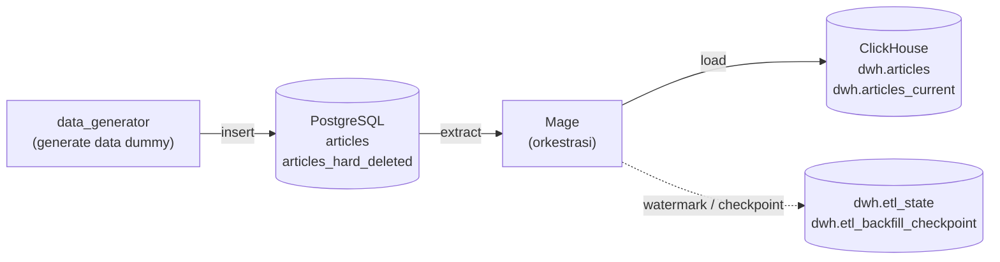

# Pipeline ETL Data Artikel Kumparan: database PostgreSQL → data warehouse ClickHouse dengan Mage untuk orchestration

Untuk menjawab skill test Data Engineer di Kumparan, dikembangkan serangkaian pipeline yang berfungsi untuk memindahkan tabel `articles` dari database operasional (PostgreSQL) ke data warehouse (ClickHouse) **setiap jam**, dilengkapi dengan penanganan data historis sejak 2016 dan penanganan sinkronisasi data yang mengalami hard delete. Seluruh sistem berjalan di Docker Compose untuk mempermudah penyamaan environment lintas device.

## Daftar isi
1. [Arsitektur](#arsitektur)
2. [Cara menjalankan](#cara-menjalankan)
3. [Desain dan alasan](#desain-dan-alasan)
4. [Problem 1: Data Historis](#data-historis)
5. [Problem 2: Hard Delete](#hard-delete)
6. [Struktur Repository](#struktur-repository)
7. [Pengujian dan demo](#pengujian-dan-demo)
8. [Penggunaan AI](#penggunaan-ai)

## Arsitektur



| Komponen | Pilihan | Alasan singkat |
|---|---|---|
| Database | PostgreSQL 16 | Familiar digunakan, punya fungsi trigger untuk mencatat hard delete |
| Warehouse | ClickHouse 24.8 | sudaht berformat seperti Warehouse kolumnar sungguhan dan dapat dijalankan di Docker. Tidak butuh akun cloud seperti GCP atau AWS, cocok untuk pengembangan |
| Orkestrasi | Mage | mudah dioperasikan via UI |


## Cara menjalankan Project

Prasyarat: Docker Desktop (Compose v2). Tidak perlu akun cloud.

```bash
git clone <repo-ini> && cd kumparan-etl-mage
cp .env.example .env          # cek kredensial lebih dahulu jika diperlukan
docker compose up -d --build
```

Perintah `docker compose up -d --build` saat pertama kali menyala langsung mengaktifkan:
- Service Postgres dan membuat tabel `articles` dan `articles_hard_deleted`, **tanpa data**.
- Service ClickHouse dan membuat database `dwh` dengan semua tabel yang dikonfigurasi sebelumnya, **tanpa data**.
- Mage aktif dan GUI-nya dapat diakses di http://localhost:6789 (project `kumparan_etl`).

Seluruh struktur tabel dibuat oleh file DDL di `postgres/init/` dan `clickhouse/init/`.

### Urutan menjalankan pipeline

Buka Mage, melalui GUI jalankan pipeline dengan urutan sebagai berikut: 
`data_generator (once)` → `data_backfill (once)` → `data_streaming (hourly)` -> `data_delete_handler (hourly)` → `data_insert_simulation (per 10 menit)` 

selain itu disediakan juga `reset_data` jika ingin mengulang pengisian data dari awal

selain via GUI, pipeline dapat dijalankan lewat CLI sebagai berikut:

```bash
# TODO: verifikasi sintaks pada versi Mage yang dipakai, lalu hapus tanda ini
docker compose exec mage mage run kumparan_etl data_generator
docker compose exec mage mage run kumparan_etl data_backfill
docker compose exec mage mage run kumparan_etl data_streaming
docker compose exec mage mage run kumparan_etl data_delete_handler
docker compose exec mage mage run kumparan_etl data_insert_simulation
```

| Langkah | Pipeline | Hasil |
|---|---|---|
| 1 | `data_generator` | mengenerate artikel dummy dengan jumlah yang dapat disesuaikan dan tersimpan di Postgres |
| 2 | `data_backfill` | mengambil seluruh data historis ke dalam database Postgres dalam bentuk partisi berdasarkan bulan |
| 3 | `data_streaming` | Memindahkan artikel baru/berubah per jangka waktu tertentu (per jam) |
| 4 | `data_delete_handler` | Menandai artikel yang dihapus fisik di database |
| 5 (opsional) | `data_insert_simulation` | Membuat aktivitas aplikasi tiruan agar dapat terlihat aktivitas update, insert, delete|


### Penjadwalan per jam

Jadwal dibuat di Mage GUI dan dapat dilihat di file `.yml` di folder tiap-tiap pipeline `mage/kumparan_etl/pipelines`.

### Memeriksa hasil

| Metode | Kredensial |
|---|---|
| Postgres (DBeaver) | Host `localhost`, port `POSTGRES_PORT`, database/user/password dari `.env` |
| ClickHouse (DBeaver) | Driver ClickHouse, host `localhost`, port `8123`, database `dwh` |
| ClickHouse (browser) | http://localhost:8123/play |

```sql
-- Data bersih yang bisa digunakan analisis (versi terbaru)
SELECT count() FROM dwh.articles_current;

-- Perbandingan baris raw data dan hasil cleansing 
SELECT count() FROM dwh.articles;
SELECT count() FROM dwh.articles FINAL;
```

## Desain dan Alasan

**Watermark `updated_at`.**
`update_at` dijadikan patokan/watermark dalam pengaliran data dari database ke warehouse agar warehouse memenuhi fungsinya dalam menangkap pergerakan dinamis data baik ketika diupdate ataupun dihapus. Watermark tiap pelaksanaan pipeline selalu terupdate dan disimpan di `dwh.etl_state`. Data warehouse menerapkan algoritma **ReplacingMergeTree** untuk menhandle versi final dari tiap perubahan yang terjadi

**Partisi bulanan berdasarkan `created_at`.** dengan dasar `created_at` tidak pernah berubah. Partisi dilakukan per bulanan untuk memudahkan backfill data historis.

**Transformasi** Standar pelaksanaan ETL dalah dengan melakukan transformasi data. Pada project ini, transformasi yang dilakukan adalah dengan standarisasi data sebagai berikut: 
semua timestamp diseragamkan ke UTC, `content` kosong diisi string kosong, dan kolom teknis (`_is_hard_deleted`, `_version`) ditambahkan. 

**Data dummy dibuat oleh pipeline Mage, struktur tabel oleh DDL.** Struktur tabel meniru skema aplikasi yang sudah ada, data dummy digenerate sekali sebelum pipeline ETL dijalankan.


## Data Historis

Situasi: 
warehouse masih kosong baru dibuat sementara database diasumsikan sudah berisi sepuluh tahun data.

Solusi:
| Pertimbangan | Penerapan |
|---|---|
| Pipelineterpisah untuk data historis dan update rutin | Pipeline `data_backfill` dan `data_streaming` |
| Partisi data | data dipecah per bulan `created_at` sebelum dialirkan ke data warehouse |
| Aman dari duplikasi | algoritma ReplacingMergeTree membuat penulisan ulang satu chunk tidak menggandakan data |
| Melindungi pipeline data streaming | Pengaman: bila perubahan melebihi 100.000 baris, run gagal dengan pesan agar memakai backfill |


## Hard Delete

Situasi: 
aplikasi menerapkan hard delete yang menghapus secara total data terhapus. Warehouse harus mampu terus menyimpan artikel yang sudah tidak ada.

Solusi:
| Solusi | Alasan | 
|---|---|---|
| **Trigger Database**  | Sederhana otomatis tertrigger tiap database mengalami hard delete| 

**Implementasi:** 
trigger `AFTER DELETE` di Postgres mencatat id yang dihapus ke `articles_hard_deleted`. Pipeline `articles_hard_delete` membaca catatan baru, mengambil versi terakhir artikel dari warehouse, lalu menulis salinannya sebagai baris baru dengan `_is_hard_deleted = 1` dan `_version` lebih tinggi. Penghapusan fisik tidak dilakukan di ClickHouse. 


## Struktur Repository

```
.
├── docker-compose.yml
├── .env.example
├── docker/mage/             
├── postgres/init/            DDL sumber: tabel, index, trigger
├── clickhouse/init/          DDL warehouse: tabel dan view
├── mage/kumparan_etl/        project Mage: pipeline, block, io_config.yaml, utils/
└── tests/                    
```

## Penggunaan AI

Pengerjaan ini dibantu AI (Claude, Anthropic). Rincian:

| Bagian | Peran AI | Peran saya |
|---|---|---|
| Analisis soal dan eksplorasi pilihan | Memilihkan data warehouse | mengerjakan dalam lingkup docker, menggunakan Postgres Database dan Mage untuk Orkestrasi ETL |
| Pengembangan Docker | Menyusun docker-compose.yml | mengatur struktur folder dan batasan apa apa saja yang dilakukan langsung di docker dan di Mage |
| SQL | mengenerate data dummy dan kerangka DDL Postgres serta Clickhouse | Pengecekan dan analisa data |
| Pipeline Mage | Evaluasi dan Saran (saran utama di bagian watermark) | Menyusun dan mengembangkan seluruh pipeline yang digunakan di project ini
| README | Menyusun Kerangka | Menjabarkan Detail |

